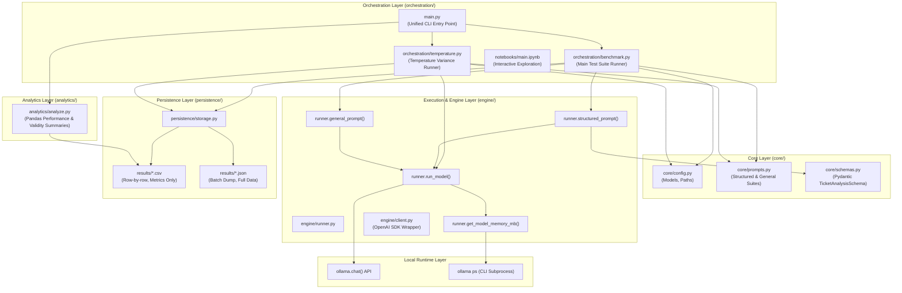
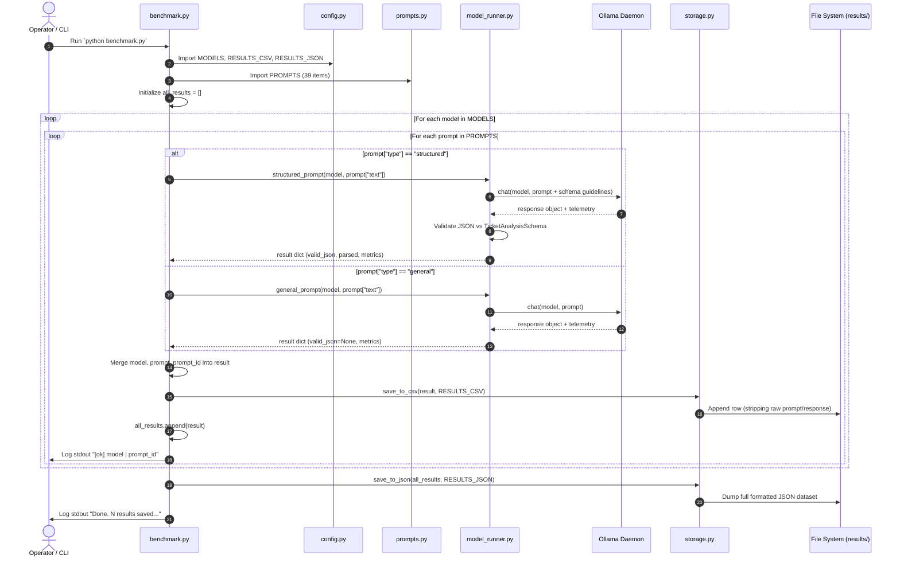
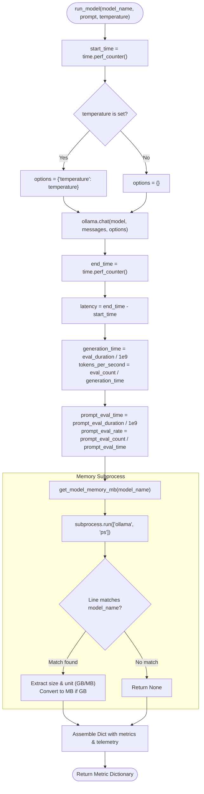
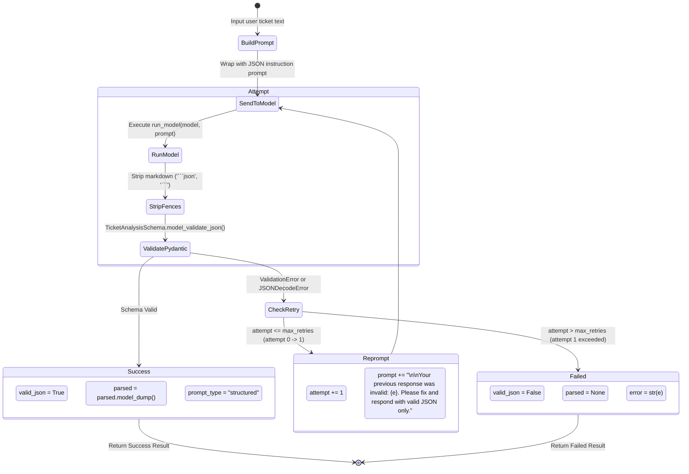
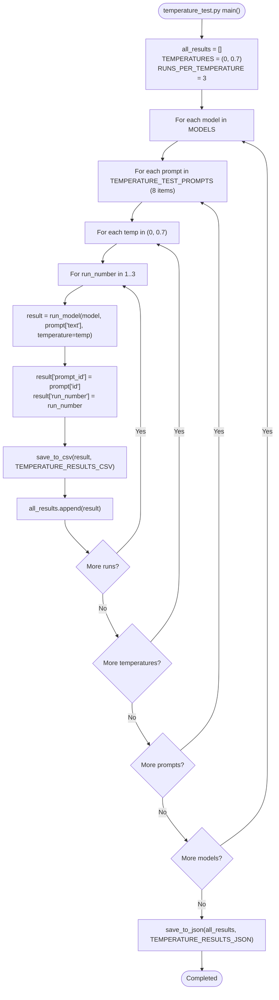
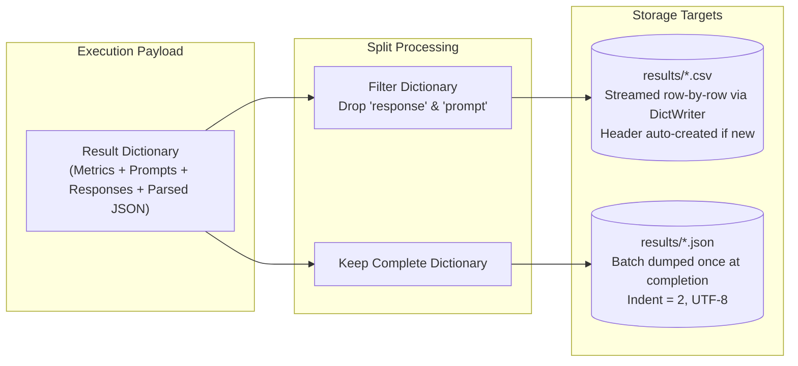
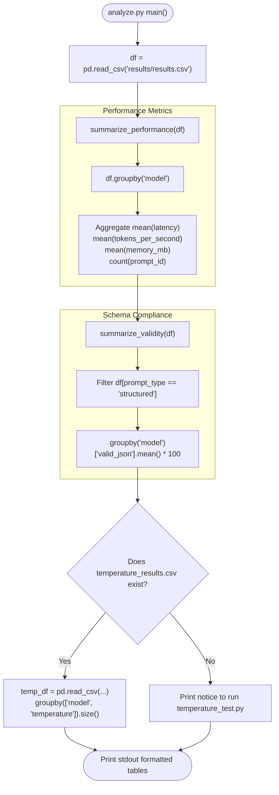

# SLM Benchmarking Application: Control Flow & Architecture Documentation

This document provides a comprehensive end-to-end control flow breakdown for the **Local Small Language Model (SLM) Benchmarking Application**. It details the execution pathways, module dependencies, state transitions, validation cycles, and data persistence strategies implemented across the codebase.

---

## 1. System Architecture & Module Inventory

The application benchmarks local small language models (running through [Ollama](https://ollama.com)) across execution latency, inference speed (tokens/sec), memory consumption (VRAM/RAM), and JSON schema compliance.

### Component Relationship Diagram



### Module Roster

| Module / Layer | Primary Role | Key Symbols / Exports |
| :--- | :--- | :--- |
| **`core/config.py`** | Configuration hub for model selection and target output paths | `MODELS`, `RESULTS_CSV`, `RESULTS_JSON`, `TEMPERATURE_RESULTS_CSV`, `TEMPERATURE_RESULTS_JSON` |
| **`core/schemas.py`** | Strict output contracts for structured tasks | `TicketAnalysisSchema` (Pydantic model) |
| **`core/prompts.py`** | Standardized multi-category test prompts with unique IDs | `PROMPTS` (39 prompts), `TEMPERATURE_TEST_PROMPTS` (8 prompts) |
| **`engine/runner.py`** | Inference calls, timing telemetry, memory probing, schema validation & retry | `run_model()`, `structured_prompt()`, `general_prompt()`, `get_model_memory_mb()` |
| **`engine/client.py`** | OpenAI SDK-compatible client wrapper connecting to Ollama | `ask_llm()`, `get_client()` |
| **`orchestration/benchmark.py`** | Primary pipeline orchestrator for full benchmark matrix | `run_benchmark()`, `main()` |
| **`orchestration/temperature.py`** | Determinism vs. creativity variance test runner | `run_temperature_test()`, `main()` |
| **`persistence/storage.py`** | Crash-safe dual storage (CSV stream & batch JSON) | `save_to_csv()`, `save_to_json()` |
| **`analytics/analyze.py`** | Aggregation, throughput statistics, and compliance reporting | `summarize_performance()`, `summarize_validity()`, `run_analysis()` |
| **`main.py`** | Unified CLI entrypoint with subcommands | `main()`, `benchmark`, `temperature`, `analyze` |
| **`notebooks/main.ipynb`** | Interactive notebook for prototyping and iterative trial runs | Exploratory cells |

---

## 2. Main Benchmark Pipeline Control Flow (`benchmark.py`)

The primary entry point executes a cartesian product of all configured models against the entire suite of standardized prompts.

### Sequence Flow



### Detailed Execution Steps

1. **Initialization**:
   - `all_results = []` is initialized to collect structured in-memory metrics.
2. **Model Loop**: Iterates through each model defined in [`config.MODELS`](file:///Users/irritatednishantgmail.com/Desktop/SLM%20App/config.py#L6-L10) (e.g., `llama3.2:3b`, `phi4-mini`, `mistral:7b`).
3. **Prompt Loop**: Iterates through 39 prompts from [`prompts.PROMPTS`](file:///Users/irritatednishantgmail.com/Desktop/SLM%20App/prompts.py#L8-L59), covering:
   - 8 Structured / Ticket classification prompts (`tic_01` – `tic_08`)
   - 8 Factual Q&A prompts (`qa_01` – `qa_08`)
   - 6 Reasoning / Logic prompts (`rs_01` – `rs_06`)
   - 6 Summarization prompts (`sm_01` – `sm_06`)
   - 6 Creative / Open-ended prompts (`cr_01` – `cr_06`)
   - 5 Edge Cases (`ec_01` – `ec_05`)
4. **Conditional Routing**:
   - If `prompt["type"] == "structured"`: Dispatches to [`structured_prompt()`](file:///Users/irritatednishantgmail.com/Desktop/SLM%20App/model_runner.py#L80).
   - Otherwise: Dispatches to [`general_prompt()`](file:///Users/irritatednishantgmail.com/Desktop/SLM%20App/model_runner.py#L110).
5. **Payload Augmentation**:
   - The returned dictionary is combined with metadata: `{"model": model, "prompt": prompt["text"], "prompt_id": prompt["id"]}`.
6. **Crash-Safe Streaming Persistence**:
   - [`save_to_csv()`](file:///Users/irritatednishantgmail.com/Desktop/SLM%20App/storage.py#L11) writes metrics to disk immediately after each prompt completes. If the run is cancelled or crashes mid-way, all completed runs remain preserved.
7. **Batch Persistence**:
   - After completing all iterations, [`save_to_json()`](file:///Users/irritatednishantgmail.com/Desktop/SLM%20App/storage.py#L27) writes the complete results array containing full response text and schema data to `results/results.json`.

---

## 3. Inference & Validation Engine Flow (`model_runner.py`)

The inference engine handles low-level timing, subprocess memory queries, schema formatting, and validation error recovery.

### 3.1 `run_model()`: Low-Level Telemetry Flow



#### Metrics Formulae

- **Total Latency**:
  $$\text{Latency} = t_{\text{end}} - t_{\text{start}} \quad (\text{seconds})$$
- **Generation Time**:
  $$\text{Generation Time} = \frac{\text{eval\_duration}}{10^9} \quad (\text{seconds})$$
- **Output Throughput**:
  $$\text{Tokens per Second} = \frac{\text{eval\_count}}{\text{generation\_time}}$$
- **Prompt Processing Rate**:
  $$\text{Prompt Tokens per Second} = \frac{\text{prompt\_eval\_count}}{\text{prompt\_eval\_time}}$$

---

### 3.2 `structured_prompt()`: Validation & Retry State Machine

The structured workflow forces the model into producing valid JSON matching [`TicketAnalysisSchema`](file:///Users/irritatednishantgmail.com/Desktop/SLM%20App/schemas.py#L10-L15) and implements an automated retry budget if parsing fails.



#### Pydantic Schema Specification

Defined in [`schemas.py`](file:///Users/irritatednishantgmail.com/Desktop/SLM%20App/schemas.py#L10-L15):
```python
class TicketAnalysisSchema(BaseModel):
    category: Literal["billing", "technical", "account", "other"]
    priority: Literal["low", "medium", "high"]
    summary: str
    requires_escalation: bool
```

---

### 3.3 `general_prompt()`: Pass-Through Flow

For non-structured tasks (Q&A, reasoning, summarization, creative, edge cases), no schema validation or retry loop is performed:
1. Calls `run_model(model_name, prompt_text)`.
2. Annotates dictionary with:
   - `prompt_type = "general"`
   - `valid_json = None`
   - `parsed = None`
3. Returns result dictionary.

---

## 4. Temperature Variance Test Flow (`temperature_test.py`)

This workflow isolates the effect of sampling temperature on output stability, latency, and determinism.



### Total Executions Calculation

$$\text{Total Runs} = |\text{MODELS}| \times |\text{PROMPTS}_{\text{subset}}| \times |\text{TEMPERATURES}| \times \text{RUNS\_PER\_TEMPERATURE}$$

With the default configuration (3 models, 8 prompts, 2 temperatures, 3 repetitions):
$$\text{Total Runs} = 3 \times 8 \times 2 \times 3 = 144 \text{ inference calls}$$

---

## 5. Persistence Strategy & Data Flow (`storage.py`)

The application implements a split persistence architecture to balance crash-safety and full data fidelity:



- **CSV Tier (`save_to_csv`)**: Lightweight and readable. Ensures tabular analysis in pandas/Excel without multiline prompt/response text breaking row delimitation. Executed after **every single inference**.
- **JSON Tier (`save_to_json`)**: Preserves the complete transcript of generated responses, full error stack traces, and parsed structured outputs for downstream validation. Executed **once at the end of the run**.

---

## 6. Analysis & Aggregation Control Flow (`analyze.py`)

After runs complete, `analyze.py` reads the CSV outputs and generates consolidated reports.



---

## 7. Complete Execution Matrix & State Transitions

| Phase | Input State | Function Called | Internal Actions | Output / Next State |
| :--- | :--- | :--- | :--- | :--- |
| **1. Config** | Startup | `import config` | Loads model names and file paths | Global constants defined |
| **2. Prompt Selection** | `prompt_id`, `type` | `benchmark.py` main loop | Determines routing branch (`structured` vs `general`) | Dispatched to specialized runner |
| **3. Structured Run** | Raw text, schema instruction | [`structured_prompt()`](file:///Users/irritatednishantgmail.com/Desktop/SLM%20App/model_runner.py#L80) | Calls `run_model()`, cleans text, parses with Pydantic | If invalid, retries with error string; returns parsed dict |
| **4. General Run** | Raw prompt text | [`general_prompt()`](file:///Users/irritatednishantgmail.com/Desktop/SLM%20App/model_runner.py#L110) | Calls `run_model()`, leaves schema validation null | Direct generation result dict |
| **5. Core Timing** | Prompt, model name | [`run_model()`](file:///Users/irritatednishantgmail.com/Desktop/SLM%20App/model_runner.py#L29) | Uses `perf_counter` around `ollama.chat()`, queries `ollama ps` | Raw latency, TPS, tokens, and RAM in MB |
| **6. Streaming Save** | Result dictionary | [`save_to_csv()`](file:///Users/irritatednishantgmail.com/Desktop/SLM%20App/storage.py#L11) | Filters out heavy text fields; appends row to CSV | Crash-safe persistent disk write |
| **7. Batch Save** | List of all results | [`save_to_json()`](file:///Users/irritatednishantgmail.com/Desktop/SLM%20App/storage.py#L27) | Writes entire in-memory list with responses | Full-fidelity JSON dataset |
| **8. Analytics** | `results.csv` | [`analyze.py`](file:///Users/irritatednishantgmail.com/Desktop/SLM%20App/analyze.py#L30) | Pandas grouping by model across throughput, latency, memory, JSON validity | Terminal report tables |

---

## 8. Summary of Findings & Next Steps

### Completed Workflows
- **Interactive Prototyping**: Validated in [`notebooks/main.ipynb`](file:///Users/irritatednishantgmail.com/Desktop/SLM%20App/notebooks/main.ipynb).
- **Core Engine**: Fully implemented in [`model_runner.py`](file:///Users/irritatednishantgmail.com/Desktop/SLM%20App/model_runner.py).
- **Dual Persistent Pipelines**: Active in [`benchmark.py`](file:///Users/irritatednishantgmail.com/Desktop/SLM%20App/benchmark.py) and [`temperature_test.py`](file:///Users/irritatednishantgmail.com/Desktop/SLM%20App/temperature_test.py).
- **Reporting**: Automated summary in [`analyze.py`](file:///Users/irritatednishantgmail.com/Desktop/SLM%20App/analyze.py).

### Potential Future Enhancements
1. **Dynamic Task Routing**: Adding additional Pydantic schemas in [`schemas.py`](file:///Users/irritatednishantgmail.com/Desktop/SLM%20App/schemas.py) (e.g., entity extraction, sentiment analysis).
2. **Asynchronous / Batch Inference**: Running concurrent requests if benchmarking multi-user throughput.
3. **Visualization Export**: Adding matplotlib/seaborn chart generation directly inside [`analyze.py`](file:///Users/irritatednishantgmail.com/Desktop/SLM%20App/analyze.py).
